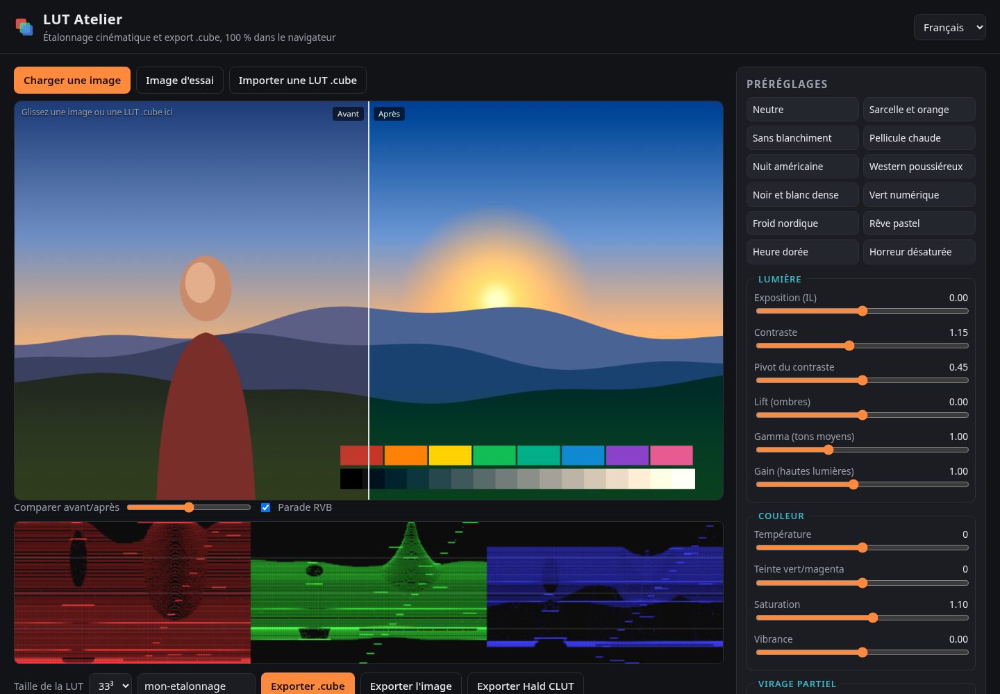
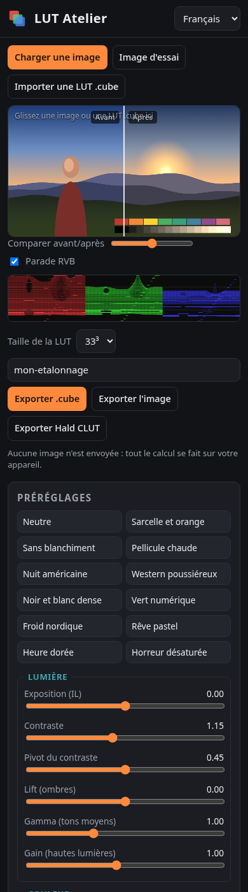

# LUT Atelier

**FR** — Créez vos propres LUT d'étalonnage cinématique directement dans le navigateur, puis exportez-les en `.cube` pour DaVinci Resolve, Premiere Pro, Final Cut Pro, After Effects, OBS ou FFmpeg. Aucun logiciel à installer, aucune image envoyée sur un serveur.

**EN** — Build your own cinematic colour-grading LUTs in the browser and export them as `.cube` files for DaVinci Resolve, Premiere Pro, Final Cut Pro, After Effects, OBS or FFmpeg. Nothing to install, nothing uploaded.

**Taqbaylit** — Snulfu-d LUT n yiniten i sinima deg yiminig, syin sifeḍ-iten s `.cube`.

👉 **Démo / Demo : https://salimadour31-boop.github.io/lut-atelier/**

## Fonctionnalités

- Aperçu en direct avec comparaison **avant/après** (curseur ou glisser sur l'image).
- **Parade RVB** pour contrôler les niveaux de chaque canal.
- Réglages : exposition, contraste et pivot, lift/gamma/gain, température, teinte vert/magenta, saturation, vibrance, **virage partiel** (teinte des ombres et des hautes lumières), fondu film, intensité globale.
- **12 préréglages originaux** : sarcelle et orange, sans blanchiment, nuit américaine, western poussiéreux, heure dorée, froid nordique…
- **Import d'une LUT `.cube` existante** pour la retoucher ou la mélanger (opacité réglable).
- Exports : **`.cube` 17³ / 33³ / 65³**, image étalonnée en PNG (pleine résolution), **Hald CLUT** niveau 8 (GIMP/G'MIC, darktable, RawTherapee, FFmpeg `haldclut`).
- Lien partageable : les réglages sont enregistrés dans l'adresse de la page.
- Image d'essai générée par le code (paysage, carnation, rampe de gris, nuancier) : aucune ressource externe.
- Interface **français / English / Taqbaylit**, responsive (bureau, tablette, mobile).

## Utilisation

1. Ouvrez la [démo](https://salimadour31-boop.github.io/lut-atelier/) (ou `index.html` en local, sans serveur).
2. Chargez une image extraite de votre vidéo (ou gardez l'image d'essai).
3. Choisissez un préréglage puis affinez avec les curseurs (double-clic sur un curseur = valeur par défaut).
4. Cliquez sur **Exporter .cube** et importez le fichier dans votre logiciel de montage :
   - DaVinci Resolve : *Project Settings → Color Management → Open LUT Folder*, ou nœud → *LUT*.
   - Premiere Pro : *Lumetri Color → Creative → Look → Browse*.
   - FFmpeg : `ffmpeg -i in.mp4 -vf lut3d=mon-etalonnage-33.cube out.mp4`

Les calculs se font en espace sRGB encodé (domaine 0–1), comme la plupart des LUT créatives. Pour des rushes en LOG, appliquez d'abord une LUT de conversion vers Rec.709, puis cette LUT.

## Structure

| Fichier | Rôle |
|---|---|
| `index.html` | Page et structure de l'interface |
| `styles.css` | Thème sombre neutre et mise en page responsive |
| `grade.js` | Moteur d'étalonnage, construction/lecture des LUT `.cube`, interpolation trilinéaire |
| `app.js` | Interface, aperçu, parade RVB, exports |
| `i18n.js` | Traductions FR / EN / Taqbaylit |

## Contribuer

Les corrections (en particulier des traductions en taqbaylit) et les nouveaux préréglages sont les bienvenus via issue ou pull request.

## Licence

[MIT](LICENSE). Code, logo et préréglages originaux ; aucune ressource tierce.
